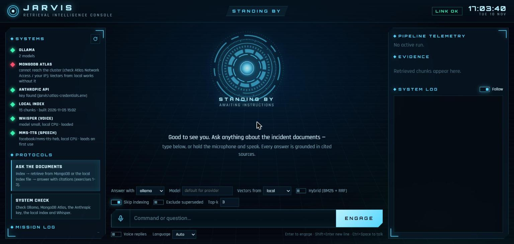
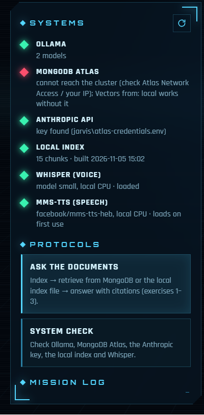
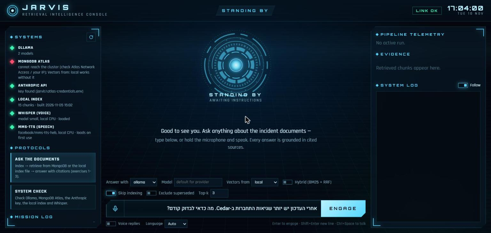
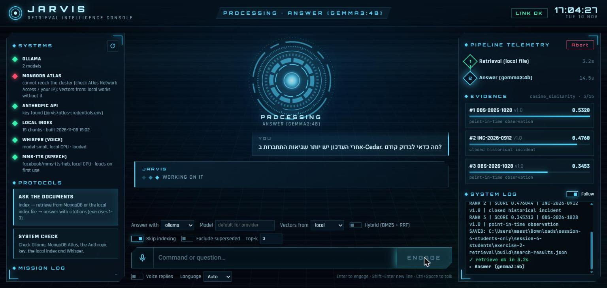
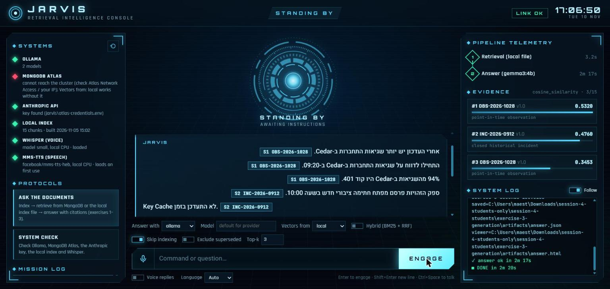

# How to run JARVIS

JARVIS is a local web console that answers questions about the incident documents with the
RAG pipeline from exercises 1–3. Embeddings and answers come from Ollama, and voice runs
locally on the CPU. By default the document vectors are read from the index file on disk,
so JARVIS needs no cloud service at all. Set **Vectors from: mongodb** to store and search
them in **MongoDB Atlas** (a cloud database) instead
(see [section 5](#5-where-the-vectors-live-local-file-or-mongodb)).



## 1. What you need

| Requirement | Why | Check |
|---|---|---|
| Python 3.10+ | runs the server and the exercise scripts | `python --version` |
| [Ollama](https://ollama.com/download) app, running | embeddings (`embeddinggemma`) and answers (`gemma3:4b`) | `ollama list` |
| MongoDB Atlas credentials file (optional, only for **Vectors from: mongodb**) | the chunk vectors are stored and searched there | `exercise-1-indexing/atlas-credentials.env` exists |
| Microphone (optional) | voice questions | — |
| Anthropic API key (optional) | only if you choose **Answer with: anthropic** | — |

## 2. One-time setup

All commands run from the `Session5/jarvis-rag` folder.

**Pull the two Ollama models** (downloads ~3.5 GB, do it before class):

```
ollama pull embeddinggemma
ollama pull gemma3:4b
```

**Install the Python packages** into the same Python that will run the server:

```
python -m pip install pymongo faster-whisper
python -m pip install torch --index-url https://download.pytorch.org/whl/cpu
python -m pip install transformers edge-tts
```

> If VS Code opens the terminal with `exercise-1-indexing\.venv` activated, `pip` installs
> into that environment. That is fine; just start the server from the same terminal.

**(Optional) Add the Atlas credentials**, only if you want **Vectors from: mongodb**.
Put `atlas-credentials.env` in `exercise-1-indexing/`:

```
MONGODB_USERNAME=...
MONGODB_PASSWORD=...
MONGODB_URI=mongodb+srv://...
```

`*.env` files are git-ignored. Never commit or share them.

**(Optional) Claude.** To be able to answer with Claude, create a `.env` file next to `rag.py`:

```
ANTHROPIC_API_KEY=sk-ant-...
```

## 3. Start the server

Terminal 1, from the `Session5/jarvis-rag` folder:

```
python jarvis/server.py
```

Expected output: `JARVIS console: http://127.0.0.1:8765  (Ctrl+C to stop)`, followed by
`WARM-UP: Speech ready: neural voice (online)`, `WARM-UP: Whisper ready` and `WARM-UP: Local voice (offline fallback) ready` as the voice models load in the background. Leave this terminal open. Stop the server with **Ctrl+C**.

Open **http://127.0.0.1:8765** in your browser. The server only listens on this computer.

## 4. Boot screen and Systems panel

On load, JARVIS runs its system checks and shows them as a boot sequence. Click **Skip** to
go straight to the console.


The **Systems** panel on the left shows the result of every check. Click the refresh icon to
check again.



| System | Green means | If it is red |
|---|---|---|
| Ollama | running, with `embeddinggemma` and `gemma3:4b` | open the Ollama app; `ollama pull` the missing model |
| MongoDB Atlas | connected, chunk count > 0 | check `atlas-credentials.env` and that your IP is allowed in Atlas; fine to ignore with the default **Vectors from: local** |
| Anthropic API | a key was found | fine to ignore when answering with Ollama |
| Local index | `exercise-1-indexing/build/index.json` exists | uncheck **Skip indexing** and ask once to build it |
| Whisper / Speech (TTS) | voice models are available; Speech shows `neural, streamed` when online | install `faster-whisper` / `edge-tts` (+ `torch` + `transformers` for the offline voice) |

## 5. Where the vectors live: local file or MongoDB

Every embed run (exercise 1) writes the chunks and their vectors to
`exercise-1-indexing/build/index.json`, and also uploads them to MongoDB Atlas when
`atlas-credentials.env` exists. The **Vectors from** option chooses which copy is used:

| Vectors from | Embed step | Retrieval step | Needs |
|---|---|---|---|
| `local` (default) | saves `index.json` only (`--no-atlas`) | reads `index.json` from disk | nothing outside your computer |
| `mongodb` | saves `index.json` and syncs Atlas | reads the vectors from Atlas | credentials + internet |

Both copies hold the same index, so the answers are the same. With the defaults (`local` and
**Answer with: ollama**), JARVIS runs fully offline. If `index.json` is missing, uncheck **Skip indexing** for
the first question to build it.

The same choice works from the command line (`--source local` is the default):

```
python rag.py --question "HTTP 401" --skip-index --source mongodb
```

## 6. Ask a question

1. In **Protocols**, keep **Ask Jarvis** selected (it sends questions to the documents and YouTube
   requests such as `find shorts about cooking` or `@MrBeast` to the YouTube Shorts MCP server).
2. Check the options above the command line. **Answer with** is `ollama` by default.
3. Type a question, for example `אחרי העדכון יש יותר שגיאות התחברות ב-Cedar. מה כדאי לבדוק קודם?`,
   and press **Enter** (or click **Engage**).



While it runs, **Pipeline telemetry** on the right shows each stage with a live timer:
Retrieval → Answer (plus Chunking and Embeddings → MongoDB when **Skip indexing** is off). **Evidence** lists the retrieved chunks with
their scores, and **System log** shows the raw output. Click **Abort** to stop a run.



> `gemma3:4b` on a CPU can take a few minutes to answer. After you edit the documents, uncheck
> **Skip indexing** for one run; only changed chunks are re-embedded.

## 7. Read the answer

The answer appears in the center as claims with citation chips. Click a chip to see the
exact source chunk it came from. If **Voice replies** is on, the answer is read aloud.



Every run is saved in `jarvis/data/runs/` and listed in **Mission log**. Click an entry to
replay it, or share a link to it as `http://127.0.0.1:8765/#run=<id>`.

## 8. Voice

Click the microphone (or press **Ctrl+Space**) and speak; the question runs automatically
when you pause. Pick the spoken language under **Language** (עברית / English / Auto) and the
engine under **Recognition**:

* **Browser (fast)** (default, Chrome or Edge): text appears while you speak and the question
  runs as soon as you stop. The audio is sent to the browser's speech service (Google / Microsoft).
* **Whisper (local)**: nothing leaves this computer; about 3 s per question on a CPU.

If the browser engine isn't available (offline, Firefox, Brave), Jarvis switches to Whisper by
itself. If the recognizer is unsure what it heard, the text stays in the box: fix it if needed
and press **Enter**. The telemetry log shows the engine and confidence of every transcript.

The first Whisper request downloads the models (Whisper `small` ~460 MB, Hebrew MMS-TTS
~145 MB) and is slow. Later requests are faster.

With an NVIDIA GPU, the Hebrew fine-tuned Whisper by ivrit.ai gives much better local Hebrew
(~1.6 GB; on a CPU it takes ~10 s per question). Set it in the server's terminal before starting it:

```powershell
$env:JARVIS_WHISPER_MODEL_HE = "ivrit-ai/whisper-large-v3-turbo-ct2"
```

## 9. Options worth knowing

| Option | Default | What it does |
|---|---|---|
| Answer with | `ollama` | `anthropic` sends the question and retrieved chunks to Claude (needs the key) |
| Model | empty | override the model; empty = `gemma3:4b` / `claude-opus-5-5` |
| Vectors from | `local` | `local` reads `exercise-1-indexing/build/index.json`; `mongodb` uses Atlas |
| Hybrid (BM25 + RRF) | off | combine vector and keyword search |
| Skip indexing | on | reuse the existing index; uncheck to re-chunk and re-embed first |
| Exclude superseded | off | drop chunks from documents marked as superseded |
| Top-k | 3 | how many chunks are sent to the model |

Environment variables (set them before `python jarvis/server.py`):

| Variable | Example | Effect |
|---|---|---|
| `JARVIS_WHISPER_MODEL` | `medium` | larger = more accurate, slower |
| `JARVIS_TTS_RATE` | `1.1` | speaking speed |

## 10. Troubleshooting

| Symptom | Fix |
|---|---|
| Page does not open | is Terminal 1 still running? Use `127.0.0.1:8765`, not `localhost` on another port |
| Ollama red: "not running" | open the Ollama app, then click refresh in Systems |
| Atlas red / "Atlas connection failed" | check the credentials file and the Atlas Network Access list, or switch **Vectors from** back to `local` |
| "Installed model changed" | `embeddinggemma` was re-pulled; uncheck **Skip indexing** and ask again |
| Voice error naming a Python path | install the missing package into exactly that Python |
| `ANTHROPIC_API_KEY is not set` | switch **Answer with** back to `ollama`, or add the `.env` file |

## 11. Tests

```
python jarvis/check_jarvis.py
```

Expected: `Ran 12 tests` and `OK`. The tests use a fake skill, so they need no model,
database or key.
